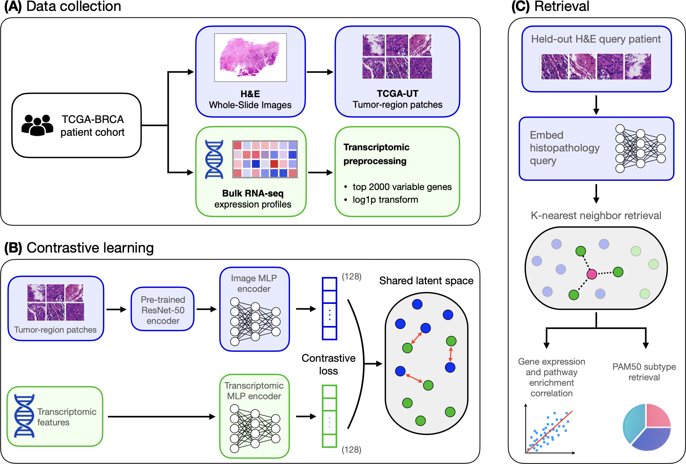

# HistoGenX

HistoGenX is a multimodal contrastive learning framework that aligns H&E histopathology images with bulk RNA-seq profiles in a shared embedding space. Using paired data from the TCGA-BRCA cohort, it learns associations between tissue morphology and molecular characteristics, enabling image-based retrieval of gene expression, pathway activity, and breast cancer molecular subtypes.

  

## Setup

Run `setup.sh` to install the required dependencies and download the dataset used for training.
